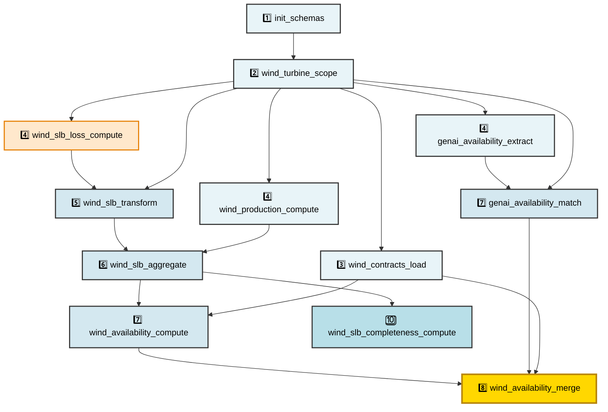

# LTSA Pipeline — Scripts & Silver/Gold Stores

## Simplified view — Execution order

---

## Detailed flowchart — Scripts & Stores

```mermaid
graph TD
    %% ─── SCRIPTS ──────────────────────────────────────────────────────────
    A["1️⃣ init_schemas"] --> B["2️⃣ wind_turbine_scope"]
    B --> C["3️⃣ wind_contracts_load"]
    B --> D["4️⃣ wind_production_compute"]
    B --> E["4️⃣ wind_slb_loss_compute"]
    B --> F["4️⃣ genai_availability_extract"]

    E --> G["5️⃣ wind_slb_transform"]
    B --> G

    G --> H["6️⃣ wind_slb_aggregate"]
    D --> H

    H --> I["7️⃣ wind_availability_compute"]
    C --> I

    H --> N["🔟 wind_slb_completeness_compute"]

    F --> J["7️⃣ genai_availability_match"]
    B --> J

    I --> K["8️⃣ wind_availability_merge"]
    J --> K
    C --> K

    %% ─── SILVER LAYER ─────────────────────────────────────────────────────
    subgraph SL["🥈 Silver Layer"]
        SA[("turbine_scheduled_pm\nmaintenance_substation\nmaintenance_farm")]
        SB[("availability_genai\nfiles_genai_processed")]
        SC[("turbine_slb")]
        SD[("availability_genai_prepared\navailability_genai_telemetry_match\navailability_genai_telemetry_no_match\navailability_genai_site_availability\nmapping_file_turbine/farm/substation")]
    end

    %% ─── GOLD LAYER ───────────────────────────────────────────────────────
    subgraph GL["🥇 Gold Layer"]
        GA[("wind_turbine_scope\ndim_farm · dim_substation · dim_turbine")]
        GB[("loss_10min_wind")]
        GC[("turbine_production\nsubstation_production\nfarm_production")]
        GD[("slb_and_production")]
        GE[("fact_turbine_availability\nfact_substation_availability\nfact_farm_availability\nianosm_budget_tracker")]
        GF[("fact_genai_turbine_availability\nfact_genai_substation_availability\nfact_genai_farm_availability")]
        GG[("fact_slb_completeness_turbine")]
        GH[("turbine_availability\nsubstation_availability\nfarm_availability")]
    end

    %% ─── S3 BUCKET ────────────────────────────────────────────────────────
    subgraph S3["☁️ S3 Bucket — stpl"]
        S3A[["<b>wind_turbine_ltsa_scope/data</b>"]]
        S3B[["<b>maintenance_substation/data</b>\n<b>maintenance_farm/data</b>\n<b>referential_guarantee_farm/data</b>"]]
        S3P[["<b>turbine_production/data</b>\n<b>substation_production/data</b>\n<b>farm_production/data</b>"]]
        S3C[["<b>slb_completeness_turbine/data</b>"]]
        S3D[["<b>turbine_availability/data</b>\n<b>substation_availability/data</b>\n<b>farm_availability/data</b>"]]
    end

    %% ─── DELTA TABLE WRITES ──────────────────────────────────────────────
    C -. write .-> SA
    F -. write .-> SB
    G -. write .-> SC
    J -. write .-> SD

    B -. write .-> GA
    E -. write .-> GB
    D -. write .-> GC
    H -. write .-> GD
    I -. write .-> GE
    J -. write .-> GF
    N -. write .-> GG
    K -. write .-> GH

    %% ─── S3 WRITES ────────────────────────────────────────────────────────
    B -. s3 write .-> S3A
    C -. s3 write .-> S3B
    D -. s3 write .-> S3P
    N -. s3 write .-> S3C
    K -. s3 write .-> S3D
```

---

## Script Reference — Description, Inputs & Outputs

> See [scripts.md](scripts.md) for the algorithm walkthrough (numbered steps, helpers, special rules) of each notebook below.

### 1. `init_schemas`

Creates the silver and gold Unity Catalog schemas if they do not already exist. This is a one-time initialization step that must run before any other notebook in the pipeline.

| Direction | Table / Path | Type |
|-----------|--------------|------|
| Input | *(none — reads schema names from widget parameters `silver_schema`, `gold_schema`)* | — |

---

### 2. `wind_turbine_scope`

Loads wind turbine and substation data from Telemetry static files and filters to the LTSA regex scope to build the `wind_turbine_ltsa_scope` reference dataset. Also computes the Kimball dimension tables `dim_farm`, `dim_substation`, and `dim_turbine` with surrogate IDs and parent-FK hierarchy links. Results are also exported to the S3 bucket.

| Direction | Table / Path | Type |
|-----------|--------------|------|
| Input | Telemetry static: `wind_turbine/data` | Parquet |
| Input | Telemetry static: `substation/data` | Parquet |
| Output | `gold.wind_turbine_scope`, `gold.dim_farm`, `gold.dim_substation`, `gold.dim_turbine` | Delta tables |
| Output | **S3: `wind_turbine_ltsa_scope/data`** | Delta |

---

### 3. `wind_contracts_load`

Loads and transforms Telemetry maintenance contracts (general contract terms, guarantee periods, flat-rate PM) into silver reference tables structured at substation and farm level. Outputs are also exported to S3 for downstream consumers.

| Direction | Table / Path | Type |
|-----------|--------------|------|
| Input | Telemetry static: `maintenance_contract_general/data` | Parquet |
| Input | Telemetry static: `maintenance_contract_guarantee/data` | Parquet |
| Input | Telemetry static: `maintenance_contract_contractual_availability_flate_rate/data` | Parquet |
| Output | `silver.turbine_scheduled_pm`, `silver.maintenance_substation`, `silver.maintenance_farm` | Delta tables |
| Output | **S3: `maintenance_substation/data`**, **`maintenance_farm/data`**, **`referential_guarantee_farm/data`** | Delta |

---

### 4. `wind_production_compute`

Reads 10-min SCADA wind data (ActivePower tag) from Telemetry, iterating over LTSA farm/year partitions for optimized Delta reads, and aggregates to monthly turbine, substation, and farm production metrics.

| Direction | Table / Path | Type |
|-----------|--------------|------|
| Input | `gold.wind_turbine_ltsa_scope` | Delta table |
| Input | Telemetry SCADA: `cds_10min_wind/data` (partitioned by `farm_code` / `year`) | Delta |
| Output | `gold.turbine_production`, `gold.substation_production`, `gold.farm_production` | Delta tables |
| Output | **S3: `turbine_production/data`**, **`substation_production/data`**, **`farm_production/data`** | Delta |

---

### 4. `wind_slb_loss_compute`

Reads 10-min wind loss data from the Telemetry Stop Log Book, joins with turbine scope to enrich events with `substation_code` and `farm_code`, then aggregates loss values per stop per month.

| Direction | Table / Path | Type |
|-----------|--------------|------|
| Input | `gold.wind_turbine_ltsa_scope` | Delta table |
| Input | Telemetry SLB: `loss_10min_wind/data` (partitioned by `farm_code` / `year`) | Delta |
| Output | `gold.loss_10min_wind` | Delta table |

---

### 4. `genai_availability_extract`

Extracts turbine availability data from PDF/Excel maintainer reports using Azure Document Intelligence (OCR) and Azure OpenAI GPT-4o. Compares available files in a Databricks Volume against a Delta tracking table to process only new files, then writes extracted and structured results to the silver layer.

| Direction | Table / Path | Type |
|-----------|--------------|------|
| Input | Databricks Volume: PDF/Excel reports under `<country>/<maintainer>/<year>/<month>/` | Binary files |
| Input | `silver.files_genai_processed` (processed-file tracking table) | Delta table |
| Output | `silver.availability_genai`, `silver.files_genai_processed` | Delta tables |

---

### 5. `wind_slb_transform`

Loads raw stop events from Telemetry, explodes multi-month stops across their target months, and applies pro-rata duration and loss allocation per month. Loss values are then refined by joining with the 10-min granular loss data. Writes to `silver.turbine_slb` with partition overwrite on the lookback window.

| Direction | Table / Path | Type |
|-----------|--------------|------|
| Input | Telemetry SLB: `stop_wind/data` | Delta |
| Input | `gold.wind_turbine_ltsa_scope` | Delta table |
| Input | `gold.loss_10min_wind` | Delta table |
| Output | `silver.turbine_slb` | Delta table |

---

### 6. `wind_slb_aggregate`

Aggregates the silver SLB by cleaning `responsible_party` and `iec_stop_category_label`, pivoting on the IEC × responsible-party combination, then joining with turbine production to produce the unified `gold.slb_and_production` table.

| Direction | Table / Path | Type |
|-----------|--------------|------|
| Input | `silver.turbine_slb` | Delta table |
| Input | `gold.turbine_production` | Delta table |
| Output | `gold.slb_and_production` | Delta table |

---

### 7. `wind_availability_compute`

Computes portfolio time and energy availabilities at turbine, substation, and farm level from SLB and production data, applying IEC above-cap algorithms and scheduled maintenance (PM) logic. Resolves dimension surrogate FKs and writes the three `fact_*_availability` tables.

| Direction | Table / Path | Type |
|-----------|--------------|------|
| Input | `gold.slb_and_production` | Delta table |
| Input | `silver.turbine_scheduled_pm` | Delta table |
| Input | `gold.dim_turbine`, `gold.dim_substation`, `gold.dim_farm` | Delta tables |
| Output | `gold.fact_turbine_availability`, `gold.fact_substation_availability`, `gold.fact_farm_availability`, `gold.ianosm_budget_tracker` | Delta tables |

---

### 7. `genai_availability_match`

Matches turbines extracted by the GenAI pipeline against Telemetry reference turbines using exact serial-number matching followed by fuzzy matching (rapidfuzz `partial_ratio`, cutoff 85). Produces silver match/no-match tables and gold fact tables (`fact_genai_turbine/substation/farm_availability`) enriched with dimension surrogate FKs.

| Direction | Table / Path | Type |
|-----------|--------------|------|
| Input | `silver.availability_genai` | Delta table |
| Input | `silver.availability_genai_prepared` (reloaded for phase 2 fuzzy matching) | Delta table |
| Input | `gold.wind_turbine_ltsa_scope` | Delta table |
| Output | `silver.availability_genai_prepared`, `silver.availability_genai_telemetry_match`, `silver.availability_genai_telemetry_no_match`, `silver.availability_genai_site_availability`, `silver.mapping_file_turbine`, `silver.mapping_file_farm`, `silver.mapping_file_substation`, `silver.mapping_file_classify_fail` | Delta tables |
| Output | `gold.fact_genai_turbine_availability`, `gold.fact_genai_substation_availability`, `gold.fact_genai_farm_availability` | Delta tables |

---

### 8. `wind_availability_merge`

Merges portfolio computed availabilities with GenAI maintainer availabilities via full-outer joins at turbine, substation, and farm levels. Applies contract management deduplication rules (active-contract priority, then most-recent) and enriches each row with guaranteed availability from maintenance contracts. Outputs the final delivery tables and exports them to S3.

| Direction | Table / Path | Type |
|-----------|--------------|------|
| Input | `gold.fact_turbine_availability`, `gold.fact_genai_turbine_availability` | Delta tables |
| Input | `gold.fact_substation_availability`, `gold.fact_genai_substation_availability` | Delta tables |
| Input | `gold.fact_farm_availability`, `gold.fact_genai_farm_availability` | Delta tables |
| Input | `gold.dim_turbine`, `gold.dim_substation`, `gold.dim_farm` | Delta tables |
| Input | `silver.maintenance_substation`, `silver.maintenance_farm` | Delta tables |
| Output | `gold.turbine_availability`, `gold.substation_availability`, `gold.farm_availability` | Delta tables |
| Output | **S3: `turbine_availability/data`**, **`substation_availability/data`**, **`farm_availability/data`** | Delta |

---

### 10. `wind_slb_completeness_compute`

Computes SLB data quality (completeness) metrics per turbine per month — the percentage of stops with a valid IEC category, measured both by row count and by duration. Resolves the surrogate FK to `dim_turbine` and exports results to S3.

| Direction | Table / Path | Type |
|-----------|--------------|------|
| Input | `silver.turbine_slb` | Delta table |
| Input | `gold.dim_turbine` | Delta table |
| Output | `gold.fact_slb_completeness_turbine` | Delta table |
| Output | **S3: `slb_completeness_turbine/data`** | Delta |
